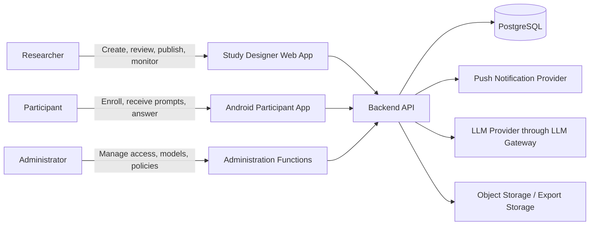
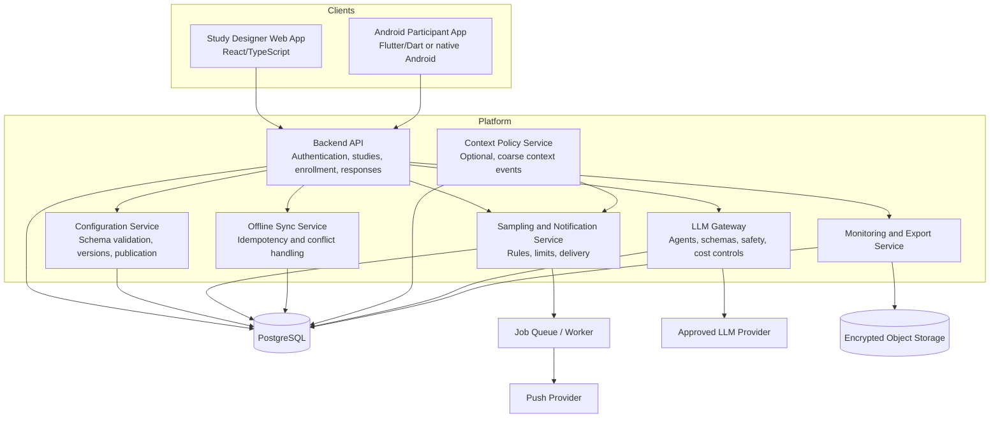
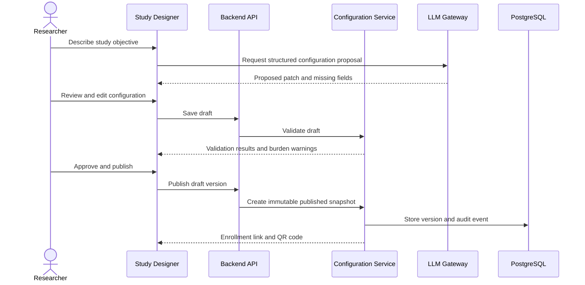

# ESM Mobile Application Architecture

## 1. Purpose and scope

This document defines the proposed architecture for the Experience Sampling Method (ESM) platform. It converts the approved project plan into an implementation blueprint for the first release and establishes boundaries for later context-aware and LLM-powered features.

The platform has three primary product areas:

1. **Study Designer web application** – allows researchers to create, review, preview, version, and publish studies through a conversational and structured interface.
2. **Distribution and enrollment service** – publishes immutable study versions and makes them available through enrollment links, invitation codes, or QR codes.
3. **Participant Android application** – downloads an assigned study configuration, delivers prompts, renders questionnaires, stores responses offline, and synchronizes them reliably.

The backend coordinates authentication, study configuration, scheduling, notifications, synchronization, LLM access, monitoring, and export.

### MVP boundary

The MVP prioritizes a dependable ESM loop:

> configure study → approve and publish → enroll participant → notify participant → collect response → synchronize securely → monitor adherence → export reproducibly

The following are deliberately deferred until the baseline is stable:

- Continuous location tracking
- Always-on microphone or camera capture
- Automatic psychological or mental-health inference
- Fully autonomous questionnaire publication
- Unreviewed AI-generated participant content
- Broad multi-sensor context collection

---

## 2. Architectural principles

### 2.1 Configuration is the shared contract

The published study configuration is the contract between the Study Designer, backend, scheduler, and Android app. It must be validated against a JSON Schema before publication.

A published configuration is immutable. Any change creates a new draft and version. Every prompt, response, displayed wording, AI execution, and export must retain the relevant study and configuration version.

### 2.2 Deterministic rules control participant contact

Study rules, consent requirements, quiet hours, cooldowns, daily limits, response windows, and notification eligibility are enforced by deterministic backend or mobile policy logic. The LLM cannot bypass them or directly issue unrestricted notifications.

### 2.3 Offline-first participant experience

The participant app must preserve drafts and completed responses during network loss, app restarts, and temporary background restrictions. Synchronization is idempotent and must not create duplicate or lost responses.

### 2.4 Data minimization and privacy by design

Collect only the context required by the approved research protocol. Prefer coarse derived labels and local processing over raw sensor streams. Participant identity, consent records, operational telemetry, context data, and research responses have separate access controls.

### 2.5 Human approval remains explicit

Researchers approve study content and publication. AI output is a proposal or bounded adaptation, not an authority. The system must retain the generated output, validation result, and human decision for reproducibility.

### 2.6 Research reproducibility

The platform records the exact study version, question version, sampling rule, displayed wording, timestamps, model, prompt version, and rule version associated with every research event.

---

## 3. System context



### External systems

| External system | Purpose | Boundary and controls |
|---|---|---|
| Push notification provider | Deliver participant prompts | No research response content in notification payloads; delivery status is recorded |
| LLM provider | Bounded question drafting, adaptation, review, or summaries | Accessed only through the LLM gateway; provider/model must be allow-listed |
| Object storage | Store generated exports and optionally encrypted artifacts | Private buckets, short-lived download links, retention policy |
| Android platform | Notifications, secure key storage, optional device context | Permissions requested individually and explained to participants |
| Identity provider or email service | Authentication and account recovery | Short-lived sessions, role-based access, MFA for researchers where available |

---

## 4. Container architecture



### Component responsibilities

#### Study Designer web application

- Chat-based study configuration assistance.
- Structured configuration editor and JSON viewer.
- Missing-field and contradiction detection feedback.
- Questionnaire and participant-flow preview.
- Draft, validate, approve, publish, pause, end, and archive actions.
- Version history and comparison.
- Enrollment link and QR-code generation.
- Adherence dashboard and export controls.

#### Backend API

- Authentication, authorization, and study-level isolation.
- Researcher, participant, and administrator operations.
- Study lifecycle and enrollment.
- Consent, withdrawal, and deletion requests.
- Response and context ingestion.
- API validation, rate limits, and audit event creation.

#### Configuration service

- Validates the shared JSON configuration.
- Stores draft and published versions.
- Prevents mutation of published versions.
- Checks unsupported question types, invalid schedules, excessive burden, missing consent, and contradictory rules.
- Provides an exact configuration snapshot to enrolled participant devices.

#### Sampling and notification service

- Supports fixed-time, random-window, and participant-initiated sampling.
- Enforces quiet hours, cooldowns, daily limits, participant pause, response windows, and expiry.
- Creates prompt instances and notification attempts.
- Records scheduling decisions and delivery status.
- Uses a worker queue for retries and time-sensitive jobs.

#### Offline synchronization service

- Accepts client-generated operation IDs.
- Makes response submission idempotent.
- Synchronizes configuration, prompts, responses, consent changes, and deletion requests.
- Preserves immutable response records and represents corrections explicitly.
- Reports synchronization state without exposing technical details unnecessarily.

#### Context policy service

The MVP begins with low-risk context such as time, day, study state, notification pause state, and connectivity. Later context sources may include coarse activity or coarse location where justified by the research protocol.

The service records source, freshness, confidence, processing location, retention, and rule version. It produces a coarse context event or decision rather than forwarding raw sensor streams by default.

#### LLM gateway

- Provides the only application path to an LLM provider.
- Allow-lists providers and models configured by an administrator.
- Validates structured input and output.
- Applies PII filtering, prompt-injection defenses, rate limits, timeouts, retries, and cost limits.
- Records model, prompt version, input references, output, validation result, latency, token use, cost, and reviewer decision.
- Returns safe fallback wording when the model is unavailable or output validation fails.

#### Monitoring and export service

- Tracks enrollment, delivery, open, completion, skip, expiry, failure, and sync metrics.
- Provides study-level and participant-level adherence views according to access permissions.
- Produces CSV and JSON exports with a data dictionary.
- Includes exact displayed wording and relevant configuration versions.
- Separates research data from operational telemetry.

---

## 5. Core workflows

### 5.1 Study creation and publication



The LLM may propose a configuration patch, but it cannot call publication directly. The researcher must explicitly approve the validated draft.

### 5.2 Participant enrollment

1. Participant opens an enrollment link, scans a QR code, or enters an invitation code.
2. The backend verifies study availability, invitation validity, participant cap, and enrollment status.
3. The participant sees study information, AI disclosure, data uses, permissions, contact details, and consent text.
4. The app records the consent version and separately records optional sensor or AI permissions.
5. The backend assigns the immutable published study version.
6. The app downloads and securely stores the configuration for offline use.

### 5.3 Prompt delivery and response

1. The scheduler evaluates the published sampling rules.
2. The policy engine checks quiet hours, cooldowns, daily limits, pause state, consent, and context constraints.
3. A prompt instance is created with the study and configuration version.
4. The notification service attempts delivery without placing sensitive response content in the notification payload.
5. The app renders the schema-defined question controls.
6. If enabled, the LLM may adapt approved wording or generate a limited follow-up within the configured policy.
7. The app stores the response locally with a unique operation ID and client timestamp.
8. The app synchronizes when connectivity is available.
9. The backend validates and records the response exactly once.

### 5.4 Withdrawal and deletion

Withdrawal stops future prompts and records the effective time. A deletion request follows the approved retention and legal process, removes or irreversibly pseudonymizes identifying links, and creates an auditable completion record. Existing research records must not be silently altered without preserving the applicable deletion/audit semantics.

---

## 6. Shared study configuration

The configuration is stored as validated JSONB with relational projections for frequently queried values. It must contain no executable code or unrestricted model instructions.

```json
{
  "schemaVersion": "1.0",
  "studyId": "study-123",
  "version": 3,
  "title": "Daily Experience Study",
  "description": "Participant-facing study information",
  "consent": {
    "version": 1,
    "text": "...",
    "aiAdaptationDisclosure": true,
    "dataProcessingPurposes": ["esm_responses"]
  },
  "lifecycle": {
    "startAt": "2026-11-01T00:00:00Z",
    "endAt": "2026-11-14T23:59:59Z",
    "timezone": "Europe/Helsinki"
  },
  "sampling": {
    "dailyLimit": 5,
    "quietHours": [{ "start": "22:00", "end": "07:00" }],
    "rules": []
  },
  "questions": [],
  "llmPolicy": {
    "adaptationAllowed": true,
    "maxFollowUps": 1,
    "approvedTopics": [],
    "researcherApprovalRequired": true
  }
}
```

Each question additionally contains:

- Stable question ID and version.
- Response type and options/range.
- Required/optional status.
- Display order and validation rules.
- Branching conditions.
- Adaptation level.
- Follow-up permission and limits.
- Participant-facing text and researcher notes where applicable.

### Configuration lifecycle

```text
Draft → Validated → Preview → Approved → Published → Paused/Ended
```

A new draft is required for every change after publication. Existing prompts and responses continue to reference the version active when they were created.

---

## 7. Data architecture

### 7.1 Core entities

#### Identity and access

- `users`
- `roles`
- `user_roles`
- `sessions`
- `devices`
- `push_tokens`

#### Study and configuration

- `studies`
- `study_memberships`
- `study_versions`
- `study_configurations`
- `configuration_validation_errors`
- `study_invitations`
- `enrollments`

#### Consent and participant rights

- `consents`
- `permission_grants`
- `withdrawal_requests`
- `deletion_requests`

#### Questionnaire and sampling

- `questionnaires`
- `questions`
- `question_options`
- `branch_rules`
- `sampling_rules`
- `quiet_hours`
- `notification_limits`
- `prompts`
- `prompt_deliveries`
- `prompt_events`

#### Responses and displayed content

- `responses`
- `response_answers`
- `response_edits`
- `displayed_wordings`
- `follow_up_questions`
- `response_flags`

#### Context, AI, and audit

- `context_permissions`
- `context_observations`
- `context_events`
- `agent_definitions`
- `prompt_versions`
- `agent_runs`
- `human_reviews`
- `safety_events`
- `audit_events`
- `usage_costs`

### 7.2 Important invariants

- Every response references the exact published study version.
- Every displayed wording references the canonical question, adaptation run, model, and prompt version when applicable.
- Client-generated operation IDs make response submission idempotent.
- Audit events are append-only.
- Published configurations cannot be edited in place.
- Participant identity is separated from ordinary research exports.
- Raw context is not retained unless explicitly justified, consented, and required.
- Response corrections create new records or correction events rather than overwriting historical facts.

### 7.3 Example response provenance

```text
Response
 ├─ study_version_id
 ├─ prompt_id
 ├─ question_version_id
 ├─ displayed_wording_id
 ├─ sampling_rule_version
 ├─ context_event_id (optional)
 ├─ client_operation_id
 ├─ captured_at_client
 └─ synchronized_at_server
```

---

## 8. Offline-first synchronization

### Local mobile storage

The Android application stores the following locally in encrypted storage:

- Published study configuration.
- Active prompts and expiry information.
- Draft and completed responses.
- Consent and permission state needed for operation.
- A synchronization queue.
- Minimal context events required by the protocol.

Encryption keys are protected using the Android platform keystore. Sensitive content is excluded from ordinary application logs.

### Synchronization protocol

Each client operation contains:

- `operationId` – globally unique client-generated identifier.
- `deviceId` – pseudonymous device identifier.
- `studyVersionId`.
- `operationType`.
- `clientCreatedAt`.
- Payload validated against the relevant schema.

The backend stores processed operation IDs. Repeating the same operation returns the original result instead of creating another response.

### Conflict policy

- Responses are immutable after acceptance.
- Participant corrections are explicit correction events.
- Server timestamps are used for synchronization ordering; client timestamps remain available for research timing.
- A response received after a prompt expiry is retained with an appropriate status rather than silently discarded.
- Clock changes and timezone changes are recorded as device events where relevant.

---

## 9. LLM and agent architecture

The LLM layer uses controlled operations rather than one unrestricted general-purpose agent.

| Operation | Input | Allowed output | Approval |
|---|---|---|---|
| `ObjectiveToConstructs` | Research objective | Candidate constructs | Researcher review |
| `ConstructsToQuestions` | Approved constructs | Candidate question schemas | Researcher review |
| `MobileWordingReview` | Approved question | Shorter/clearer alternatives | Researcher approval for publication |
| `BiasAndAmbiguityCheck` | Question schema | Findings and explanations | Researcher decision |
| `BurdenEstimator` | Questionnaire | Estimated effort and warnings | Informational/reviewable |
| `BranchingReview` | Branch rules | Contradiction/unreachable warnings | Researcher decision |
| `QuestionAdaptation` | Approved question, permitted context | Wording only within policy | Runtime validation |
| `FollowUpGeneration` | Approved response and topic boundary | At most configured follow-up | Runtime validation and policy |
| `AggregateSummary` | Authorized aggregated data | Traceable summary | Researcher review |

### LLM safety rules

- The model cannot publish, modify, or end a study.
- The model cannot change a construct, response scale, requiredness, daily limit, consent requirement, or safety rule through wording adaptation.
- Participant data is not sent to an external provider unless the deployment, consent, and privacy review explicitly allow it.
- AI-generated participant content must be identified where required by the protocol.
- Structured output is schema-validated before use.
- Invalid, unsafe, unavailable, or late output uses deterministic fallback wording.
- No diagnosis, clinical advice, unsupported psychological inference, or emergency-care impersonation.
- Prompt and model versions are retained for reproducibility.

### Runtime adaptation contract

The adaptation agent receives only:

- Approved question schema.
- Permitted wording variation level.
- Explicitly allowed context labels.
- Study and question version.
- Follow-up limit and topic boundary.

It returns:

- Validated question ID and version.
- Adapted wording.
- Unchanged response schema.
- Optional rationale and confidence for audit/review only.
- Model and prompt metadata.

---

## 10. Security, privacy, and ethics

### Access control

- Researchers can access only studies they own or are explicitly assigned to.
- Participants can access only their enrollment and responses.
- Administrators manage platform policies but should not automatically receive unrestricted research content.
- Least privilege is applied to service accounts and exports.
- Researcher MFA should be enabled before production use.

### Data protection

- HTTPS for all network traffic.
- Encryption at rest for database, object storage, backups, and mobile local storage.
- Separate identity mapping from pseudonymous research data.
- No access tokens, response text, or raw location in ordinary logs.
- Private export storage with short-lived download links.
- Key rotation and backup encryption.

### Consent and participant rights

Consent is versioned and granular. The platform distinguishes at least:

- Survey responses.
- Notifications.
- Each optional context/sensor category.
- LLM processing.
- Data sharing with researchers.
- Long-term storage.

The app provides understandable explanations before permission requests, a support contact, temporary notification pause, withdrawal, and deletion-request flows.

### Context privacy

For every proposed context field, record:

| Field | Why needed | Source | Raw or derived | Processing location | Retention | Consent |
|---|---|---|---|---|---|---|
| Activity state | Suppress prompts during unsafe activity | Motion sensor | Derived | Prefer local | Study duration | Optional |

---

## 11. Reliability and operations

### Background jobs

Use a worker queue for:

- Prompt scheduling and delivery retries.
- Expiry processing.
- Synchronization reconciliation.
- Export generation.
- Retention and deletion jobs.
- Usage and cost aggregation.

### Observability

Track technical and research-operation metrics separately:

- API latency and error rate.
- Queue depth and job failures.
- Notification delivery failures.
- Configuration validation failures.
- Sync retry count and age of oldest pending operation.
- Enrollment, opened, completed, skipped, expired, and withdrawn prompts.
- App version and device compatibility.
- LLM latency, validation failures, fallback rate, tokens, and cost.

Never use adherence metrics alone to label participants as non-compliant. Technical delivery, timing, burden, network conditions, and participant choice must be considered.

### Backup and recovery

- Encrypted automated database backups.
- Defined retention schedule.
- Periodic restoration tests.
- Documented recovery point and recovery time objectives before production.
- Export checksums and configuration/version metadata for reproducibility.

### Deployment environments

Separate at least:

- Local development.
- Test/staging with synthetic data.
- Pilot/production with approved participant data.

Secrets are supplied through environment configuration or a secrets manager and are never committed to source control.

---

## 12. Testing strategy

### Unit tests

- Sampling windows, randomization, timezones, and daylight-saving transitions.
- Quiet hours, cooldowns, daily limits, and response expiry.
- Branching rules and question validation.
- Context policy evaluation.
- Pseudonymization and export transformations.
- Idempotent synchronization and retry behavior.
- LLM schema validation and deterministic fallback behavior.

### Integration tests

- Study publication to participant configuration download.
- Enrollment and consent version capture.
- Scheduler to notification delivery status.
- Offline response to later synchronization.
- Duplicate operation submission.
- Withdrawal and deletion processing.
- Exact-wording export and data dictionary generation.
- LLM gateway provider failure and fallback.

### Android tests

- App restart during an unanswered prompt.
- Network loss before and after submission.
- Device reboot and timezone change.
- Notification permission denied.
- Battery-saver/background restrictions.
- Push-token rotation.
- Screen-reader labels, contrast, text scaling, and small-screen layouts.

### Research-quality checks

- Completion time and response rate.
- Missingness by question and time window.
- Notification burden and context-trigger frequency.
- Implausibly fast or contradictory responses flagged for review, not automatically deleted.
- Reproducibility of sampling and displayed wording.

### AI-specific tests

- Construct preservation during wording adaptation.
- Leading, ambiguous, double-barrelled, or unsafe wording detection.
- Prompt-injection and data-exfiltration resistance.
- No publication without explicit approval.
- No unintended identifying data transfer to an external model.
- Correct handling of provider timeout, invalid output, and cost limits.

---

## 13. Recommended implementation sequence

1. Finalize protocol, ethical constraints, data classification, and MVP scope.
2. Define and validate the shared study JSON Schema.
3. Implement database migrations, authentication, roles, and study isolation.
4. Implement study lifecycle, immutable versions, validation, and audit events.
5. Implement questionnaire types, branching, sampling rules, and preview.
6. Build the researcher Study Designer and publication flow.
7. Implement enrollment, consent, QR/deep links, and participant caps.
8. Build the Android questionnaire renderer and notification flow.
9. Add encrypted local storage, idempotent synchronization, and withdrawal.
10. Implement fixed/random/participant-initiated sampling with limits and quiet hours.
11. Add monitoring, adherence views, CSV/JSON export, and data dictionary.
12. Add the LLM gateway for researcher review and approved wording adaptation.
13. Add one low-risk context source only if justified by the protocol.
14. Run technical and small user pilots; fix reliability and burden issues.
15. Harden security, backup, retention, deletion, and production operations.

---

## 14. Architecture decisions and open questions

### Decisions captured

| Decision | Rationale |
|---|---|
| PostgreSQL for transactional data | Strong consistency, relational study data, auditability, and JSONB support for validated configurations |
| Immutable published study versions | Preserves research reproducibility and prevents silent protocol changes |
| Offline-first Android app | Mobile connectivity is intermittent and responses must not be lost |
| Deterministic notification policy | Prevents uncontrolled participant interruption and protects protocol validity |
| LLM behind a gateway | Centralizes provider controls, validation, auditing, privacy filtering, and cost limits |
| Coarse/local context by default | Reduces privacy and battery risk while retaining protocol-relevant signals |
| CSV and JSON export with exact wording | Supports analysis and preserves what participants actually saw |

### Questions to resolve before implementation

- Will the first mobile release use Flutter or native Android?
- Which identity provider or authentication method is approved?
- Which LLM provider may process researcher and participant text, and where is it hosted?
- What Android versions and device classes must be supported?
- What are the approved retention, deletion, backup, and data-residency policies?
- Which context source, if any, is required for the initial study protocol?
- What are the target prompt volume, participant count, availability, and recovery objectives?
- Which ethics/IRB and GDPR roles apply to the deployment?

These questions should be resolved during the requirements and protocol milestone. They should not be hidden inside implementation details.

---

## 15. Definition of architecture readiness

The architecture is ready for implementation when:

- The shared study configuration schema is agreed and testable.
- Published versions are immutable and traceable from prompt to response.
- Participant identity and research data boundaries are documented.
- Consent, withdrawal, deletion, and optional context permissions are defined.
- Offline synchronization and idempotency behavior are specified.
- Notification policy rules and limits are deterministic.
- LLM inputs, outputs, approval points, fallback behavior, and audit fields are defined.
- MVP exclusions are accepted by the project stakeholders.
- The open questions above have owners and target decisions.
